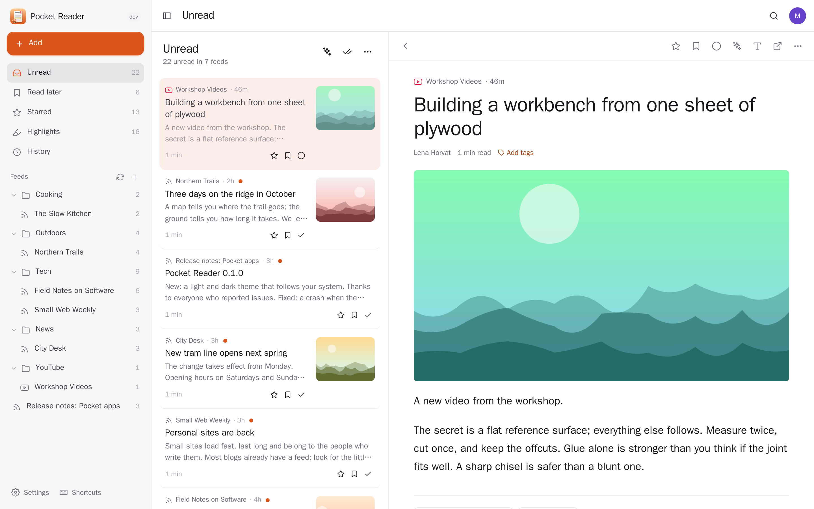
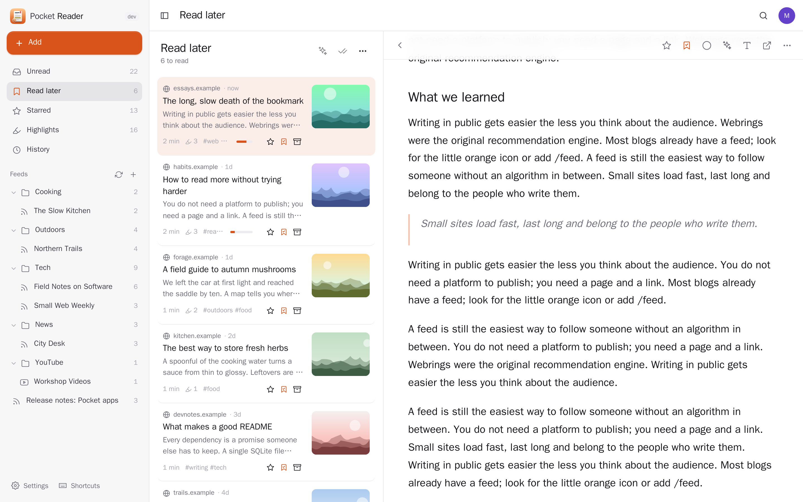
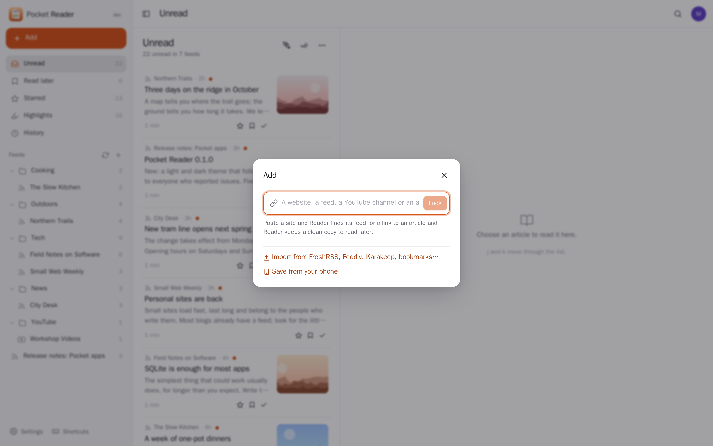
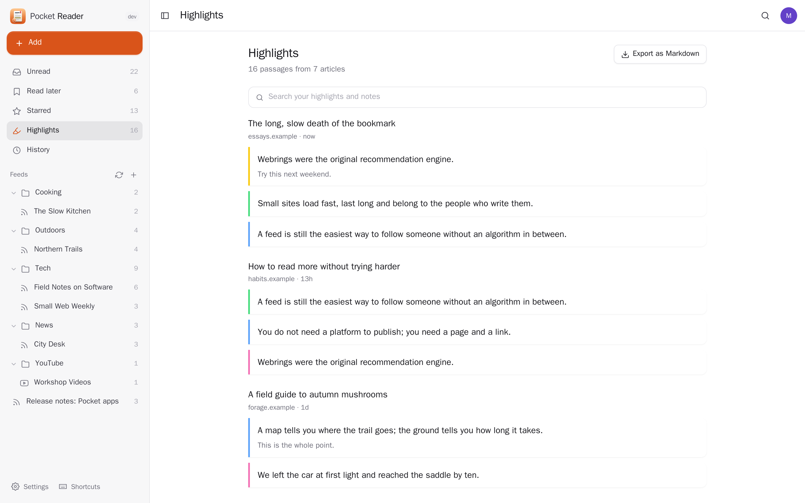
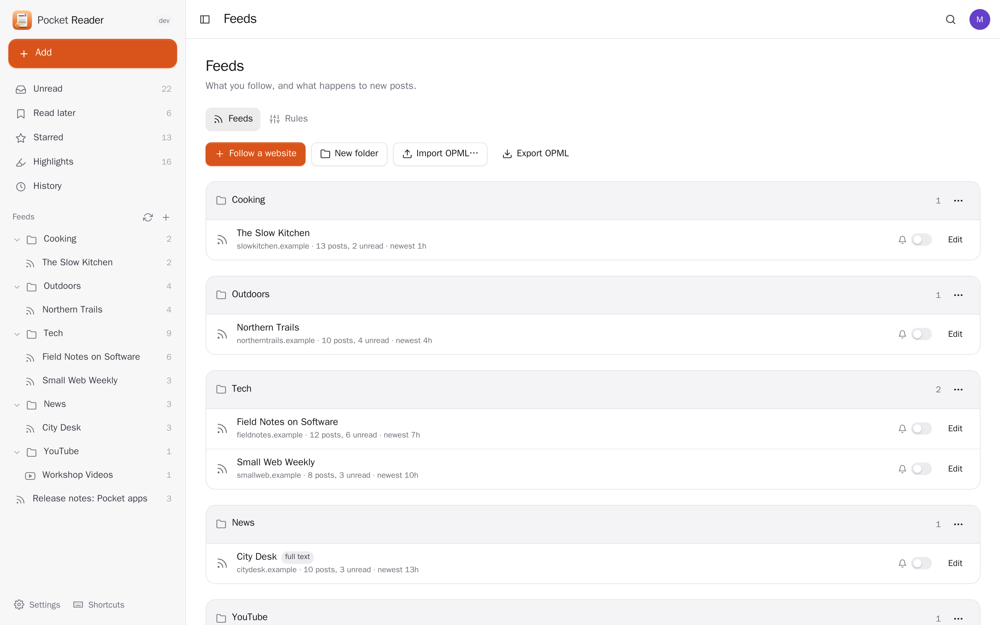
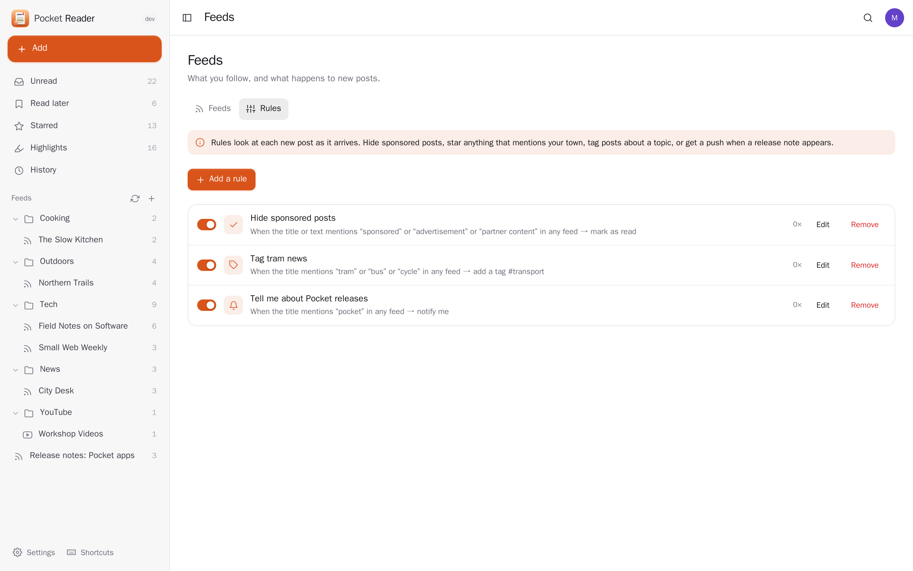
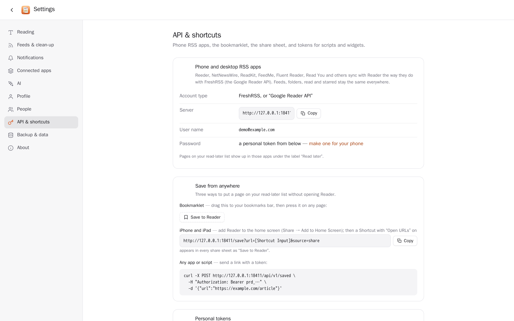
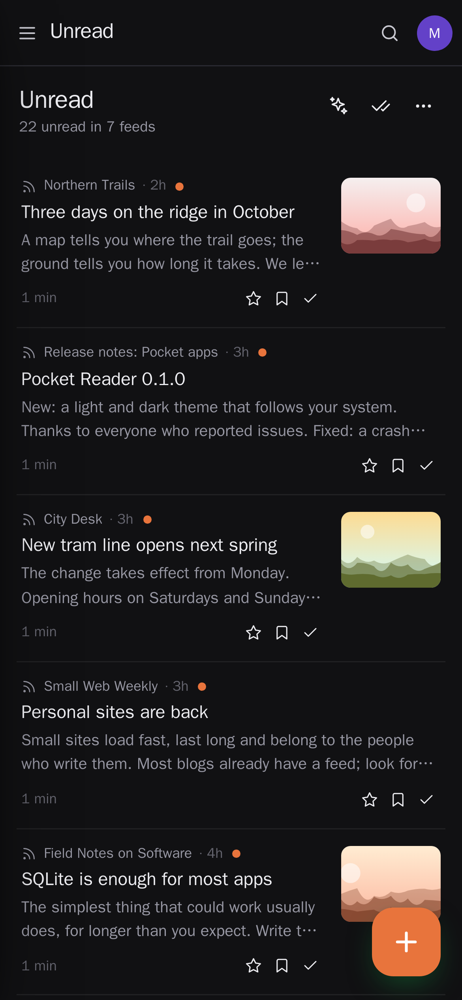
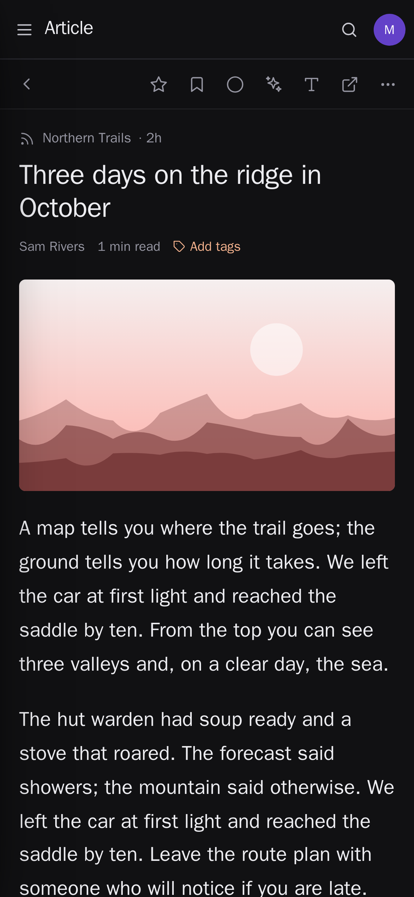
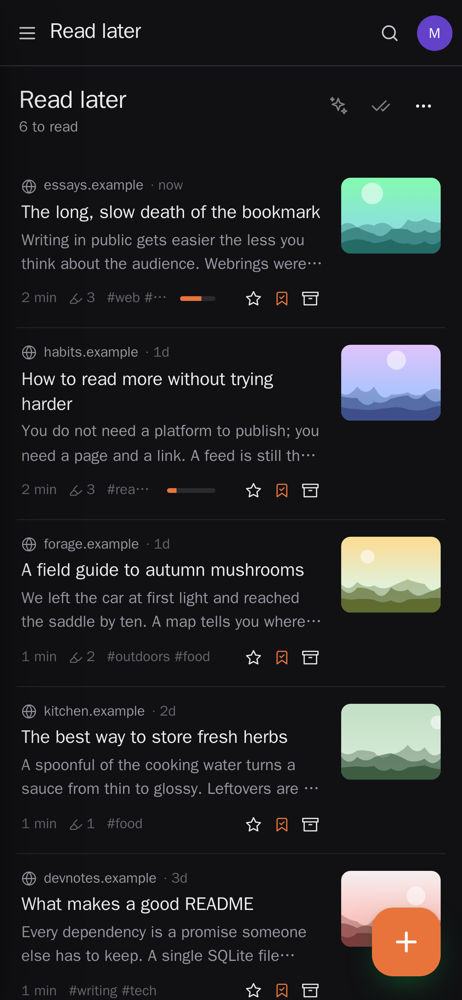

<p align="center"></p>
<h1 align="center">Pocket Reader</h1>
<p align="center">Your feeds and your read-later list in one calm place. Follow websites, blogs, newspapers and YouTube channels — paste any address and Reader finds the feed — and save any page to read later as a clean article without the noise around it. Highlight passages and keep them in your notes, search everything you ever read, let rules hide sponsored posts or star what mentions your town, and let AI summarise a post or catch you up on what is unread. Your phone's RSS app keeps working: Reader speaks the Google Reader API, like FreshRSS. Moving in is one file: OPML from any reader, a Karakeep export, browser bookmarks or a CSV from Pocket, Instapaper or Omnivore.<br>One Go binary, one SQLite file, one volume. Part of the Pocket apps; works on its own too.</p>
<p align="center">
  <a href="https://github.com/abjelosevic88/pocket-homelab-reader/actions"></a>
  <a href="https://github.com/abjelosevic88/pocket-homelab-reader/pkgs/container/pocket-homelab-reader"></a>
  <a href="LICENSE"></a>
</p>

---

<p align="center"></p>

<table>
  <tr>
    <td width="50%"></td>
    <td width="50%"></td>
  </tr>
  <tr>
    <td align="center"><sub>Read later: clean articles, progress kept, highlights in four colours.</sub></td>
    <td align="center"><sub>Paste any address: Reader finds the feed, or keeps the page to read later.</sub></td>
  </tr>
  <tr>
    <td width="50%"></td>
    <td width="50%"></td>
  </tr>
  <tr>
    <td align="center"><sub>Highlights with your notes, searchable, exported to Markdown or Pocket Notes.</sub></td>
    <td align="center"><sub>Feeds in folders: notify, whole articles, pace, OPML in and out.</sub></td>
  </tr>
  <tr>
    <td width="50%"></td>
    <td width="50%"></td>
  </tr>
  <tr>
    <td align="center"><sub>Rules: mark read, star, save, tag or notify — tried on recent posts first.</sub></td>
    <td align="center"><sub>Reeder, NetNewsWire and friends sync through the Google Reader API.</sub></td>
  </tr>
</table>

<p align="center">
  &nbsp;&nbsp;
  &nbsp;&nbsp;
  
</p>

## What it does

- **Follow anything**: RSS, Atom and JSON feeds; paste a website and its feed is found (links on the page, then the usual addresses); a YouTube channel or playlist becomes a feed with the video in the post. Folders, your own names, a pace per feed, conditional requests, failing feeds tried less and less often.
- **Read later**: save any page from the + button, a bookmarklet, the phone's share sheet or the API; Reader keeps a clean copy of the article (readability), so it can be searched and highlighted. Reading progress is kept; finished articles go to the archive.
- **A reader that stays out of the way**: serif or sans, size, width, spacing, paper / sepia / night pages; posts that send only a summary can fetch the whole article. Keyboard throughout (`j`/`k`, `s`, `l`, `m`, `v`, `?`).
- **Highlights**: select text, pick a colour, add a thought. Every highlight in one searchable list, as Markdown, or as a note per article in Pocket Notes that updates itself.
- **Search** everything you have read or saved (SQLite full-text), plus tags.
- **Rules** on new posts: when the title, author, address or text mentions words → mark read, star, save, tag or notify; try a rule on recent posts before saving it.
- **AI** (Pocket AI or your own OpenAI-compatible key): a summary of any article, a "catch me up" briefing of what is unread with links to the posts, tags for saved pages, questions about what you read.
- **Notifications** through Apprise, ntfy or a webhook: new posts from the feeds you choose, a morning digest, a feed that stopped working.
- **Phone apps**: the Google Reader API at `/api/greader.php`, so Reeder, NetNewsWire, ReadKit, FeedMe, Fluent Reader and Read You sync feeds, folders, read and starred.
- **Imports and exports**: OPML in and out; Karakeep, browser-bookmark HTML and CSV imports; a full JSON export (feeds, kept articles with their text, highlights, rules) that imports twice without duplicates.
- **Tidy by itself**: old read posts go after a month, unread after four (your choice); starred, saved, highlighted and noted posts are never removed, and removed posts do not come back.
- **Everyone their own**: each person has their own feeds, articles, highlights, settings and connections; admins see no one else's.

## Run it

```sh
docker run -d --name pocket-reader -p 8080:8080 -v ./data:/data \
  -e BASE_URL=https://reader.example.com -e SECURE_COOKIES=true \
  ghcr.io/abjelosevic88/pocket-homelab-reader:latest
```

or `docker compose up -d` with [docker-compose.yml](docker-compose.yml). Open it, create the first account and paste your first site. Feeds on your own network (an RSS-Bridge) need `FETCH_PRIVATE=true`. All options: [docs/configuration.md](docs/configuration.md). API: [docs/api.md](docs/api.md).

## With Pocket Core

Set `CORE_URL` and `CORE_REGISTRATION_KEY` and Reader joins the box: people sign in with Pocket Core, highlights go to each person's own Pocket Notes through an app link (nothing to paste), and summaries come from Pocket AI. Other Pocket apps can read what you read (`reading:read`: Pocket Day's journal) or save pages here (`reading:write`: a link from Pocket Clips); an app may remove only what it saved. Events on the bus: `reader.saved`, `reader.finished`, `reader.highlighted`, `reader.subscribed`. Without Core the Notes connection can be made directly with a URL and a token; the Core-only choices stay visible, greyed out.

## Develop

```sh
make dev     # API on :8080 with demo data + Vite on :5173
make test    # go vet, go test, tsc
make         # web + binary
```

MIT licensed.
